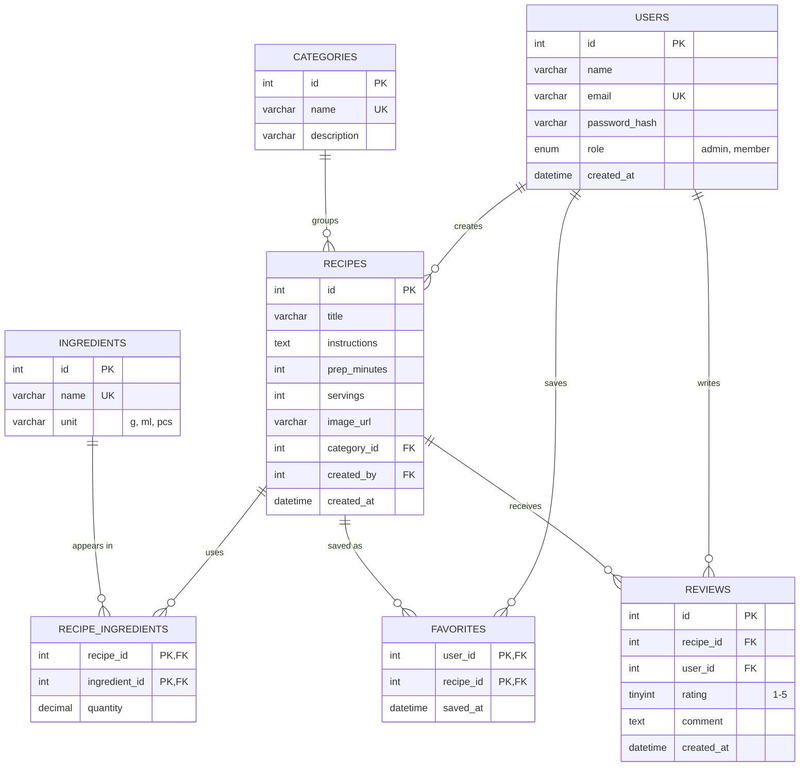

# PantryPal: draft ERD (Milestone 1)

## Entities
1. **users**: accounts with a role (`admin` or `member`).
2. **categories**: recipe groups such as Breakfast, Dessert, Vegetarian.
3. **ingredients**: the shared list of ingredients users can pick from.
4. **recipes**: a recipe with instructions, belonging to one category and created by one user.
5. **reviews**: a user's rating and comment on a recipe.
6. **recipe_ingredients** (junction): which ingredients a recipe needs, with quantity.
7. **favorites** (junction): recipes a user has saved.

## Relationships
- A category has many recipes; a user creates many recipes (1:N each).
- Recipes and ingredients are many-to-many through `recipe_ingredients`.
- Users and recipes are many-to-many through `favorites`.
- A user writes many reviews and a recipe receives many reviews (1:N each). Suggested rule for M3: one review per user per recipe.

## How "What can I cook?" works
The user enters ingredient names. The backend finds recipes whose required ingredients are all (or mostly) covered by the entered list, using `recipe_ingredients`, and ranks them by how many ingredients match. The same search also queries TheMealDB's filter-by-ingredient endpoint, so external meals appear alongside the app's own recipes.
