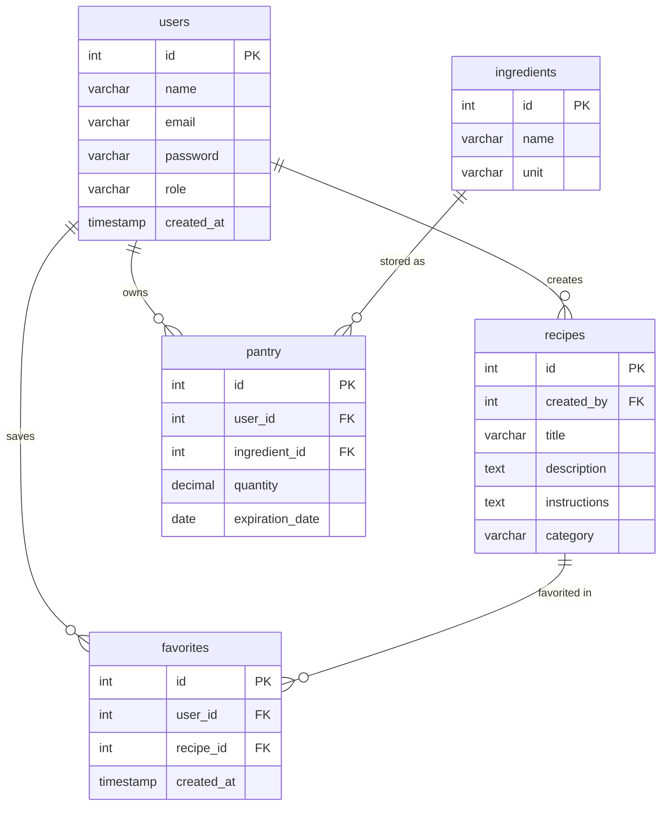

**What is "What can i cook?"**
What can i cook is a feature that lets users input ingridients they have on hand and the backend connects the input with the db which outputs all the meals that are covered by all (or most) ingridients the user picked.