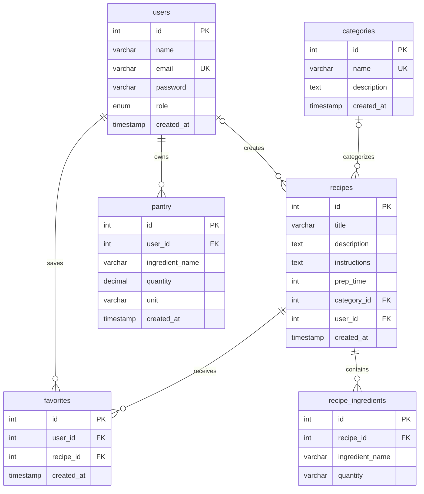

`recipes.category_id` and `recipes.user_id` are nullable foreign keys. Deleting a category sets `recipes.category_id` to `NULL`; deleting a user cascades to that user's recipes, pantry rows, and favorites. Deleting a recipe cascades to its recipe ingredients and favorites. The `favorites` table has a unique constraint on (`user_id`, `recipe_id`) to prevent duplicate favorites.

**What can I cook?**
The pantry matching feature compares ingredient names in `pantry` with `recipe_ingredients` and returns recipes ranked by the number of matching ingredients.